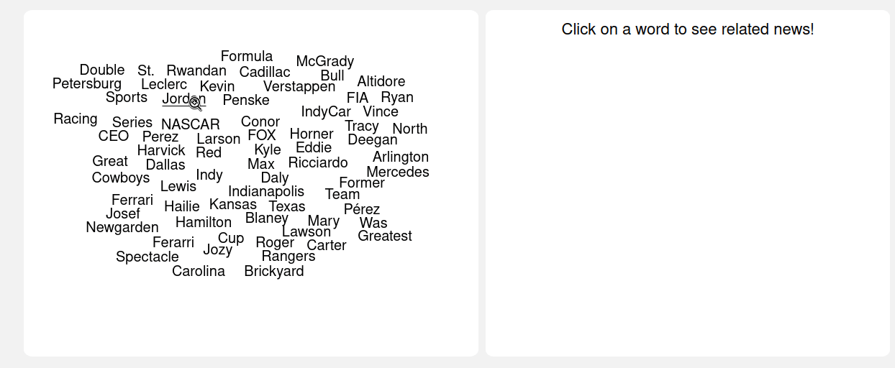

# FeedNimbus

FeedNimbus is a feed client that seeks to improve content exploration presenting feed items grouped not by source, but by subject. The main topics are extracted from all items, and shown in a wordcloud. Also, this content presentation has the aim to avoid the scrolling prevalent in most social media.



Simplicity is a concern here. The UI seeks to be minimalist and no frameworks are used.

## Installing

FeedNimbus is a frontend application with one small backend endpoint. The
backend fetches feed XML so feeds do not need to permit browser CORS requests;
parsing, topic extraction, and rendering remain in the browser. The shared
handler uses the standard Fetch API, while small adapters connect it to each
hosting platform. There are no runtime package dependencies or build step.

1. Clone the repository;

2. Start the dependency-free development server with Node.js 18 or newer:

```bash
npm run dev
```

3. Open `http://localhost:8888`;

4. Click on _Settings_ and set up your feed list and, optionally, a list of
   stopwords;

5. Click on _Reload_ to get the wordcloud from your feeds.

The browser requests `/api/rss`, and the backend fetches each HTTP(S) feed. If
only some configured feeds fail, the feeds fetched successfully are still
shown.

The entries exposed by each feed are treated as its most recent news. FeedNimbus
does not add date filtering, sorting, or deduplication.

## Deploying

### Netlify

Create a Netlify site from this repository. `netlify.toml` publishes the
`static` directory and deploys the thin adapter in `netlify/functions`
automatically.

### Other platforms

`server/rss-proxy.mjs` exports a platform-neutral function that accepts a web
`Request` and returns a web `Response`. Import `handleRssRequest` from that file
in the platform's HTTP or serverless adapter and route `/api/rss` to it. The
included `server/dev.mjs` is also a complete, dependency-free Node.js server
that can be used in production on platforms that run persistent Node processes.
